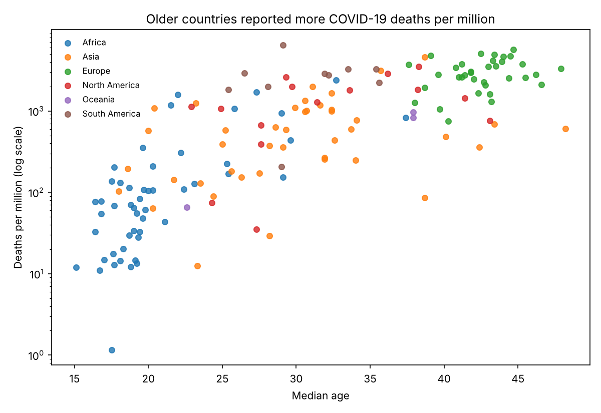

# COVID-19: What Explains Deaths per Million Across Countries?

A country-level analysis of the Our World in Data COVID-19 dataset (Jan 2020 to Aug 2024), covering data cleaning, a global timeline, and a regression of deaths per million on age, wealth, health system and policy factors. Includes 29 unit tests for the cleaning, feature and model code.

**Tools:** Python, pandas, statsmodels, matplotlib, unittest/pytest, Jupyter

## Questions

1. How did global cases and deaths change over the whole pandemic?
2. Which country characteristics go with higher deaths per million?
3. Do those relationships hold when the other factors are controlled for?

## Key findings

| Finding | Result |
|---|---|
| Countries analysed | 156 with at least 1M people and reported deaths (130 with complete data for the model) |
| Peak month for cases | January 2022 |
| Peak month for deaths | January 2021 |
| Strongest rank correlation with deaths per million | Median age (Spearman 0.80), then GDP per capita (0.68) and hospital beds (0.62) |
| Regression fit | R² 0.65 (adjusted 0.64) on log10 deaths per million |
| Significant after controls | Median age (+0.44 per SD), GDP per capita (+0.24), mean stringency (+0.16) |
| Not significant after controls | Hospital beds, diabetes prevalence, peak vaccination |
| Median deaths per million, highest | South America 2,811 and Europe 2,796 |
| Median deaths per million, lowest | Africa 77 |

Hospital beds correlate with deaths on their own but add nothing once age is in the model, so they mostly track the same thing as age and wealth.



## Project structure

```
covid-country-outcomes/
├── data/
│   ├── download_data.py        # downloads the OWID dataset (not committed, ~100 MB)
│   └── raw/                    # created by the download script
├── src/
│   ├── clean.py                # drop aggregates, fix revisions, remove duplicates
│   ├── features.py             # country summary table, monthly global totals
│   ├── modeling.py             # standardised OLS model
│   └── analysis.py             # runs everything, saves figures and results.json
├── tests/                      # 29 unit tests
├── notebooks/
│   └── 01_country_outcomes_analysis.ipynb
└── reports/
    ├── figures/
    └── results.json
```

## How to run

```bash
pip install -r requirements.txt
python data/download_data.py      # one-time download
python -m src.analysis            # regenerates figures and reports/results.json
python -m pytest tests -q         # run the tests
jupyter notebook notebooks/       # open the notebook
```

## Data cleaning

- Removed 12 aggregate rows (World, continents, income groups). OWID leaves the continent empty for these. Filtering on the continent field is safer than on the `OWID_` code prefix because Kosovo has such a code but is a real country.
- Made cumulative case and death totals non-decreasing within each country, so downward revisions do not appear as falling totals.
- Set negative daily counts to missing and removed repeated country-days. This dataset version contained no negative daily values, so that step did not change anything here, but it is tested and protects against other versions of the file.

## Testing

The tests in `tests/` cover:

- Aggregate removal, including the Kosovo edge case and empty input
- Negative-value handling, zero values and that the input is not modified
- Monotonic totals with unsorted input and multiple countries
- Duplicate days and that the cleaning pipeline gives the same result when run twice
- Per-million and fatality-rate calculations against hand-computed values, and zero-case countries
- The regression on synthetic data where the true driver is known

## Limitations

- Reported deaths are not true deaths. Richer countries tend to test and register deaths more completely, which likely explains part of the positive GDP effect. This analysis does not test that.
- The stringency coefficient is not causal. Countries with severe outbreaks adopted stricter measures.
- Median age, GDP and hospital beds are correlated, so individual coefficients are less stable than the overall fit.
- Peak vaccination is the highest share fully vaccinated, not the timing, so it cannot show whether vaccines reduced deaths in specific waves.
- Country averages hide variation within countries and over time.

## Data and credit

Data: [Our World in Data COVID-19 dataset](https://github.com/owid/covid-19-data), which compiles Johns Hopkins University case counts with national statistics.

## Author

Tanisha · [GitHub](https://github.com/tanishaa11)
